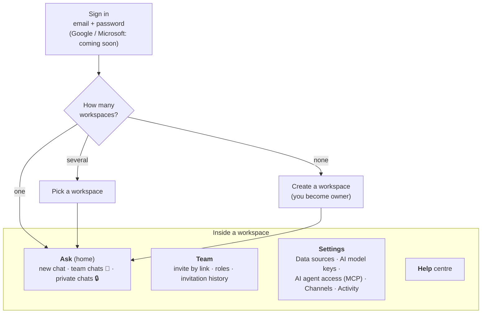

# 1. Product

[← Design docs](README.md) · next: [Architecture →](2-architecture.md)

**Genie is one assistant that answers questions from a company's own systems, wherever its staff already work.**

| | |
|---|---|
| **Who uses it** | A company's staff (e.g. C21's property agents), and outside AI apps the company allows |
| **Where they ask** | Web (Ask) · Slack · WhatsApp · Claude / ChatGPT / own agents through Genie's MCP server |
| **What it reads** | The company's own systems, **live at the moment of the question**: Odoo and the company's document index (Azure AI Search). SQL databases next |
| **What it can change** | Odoo leads, contacts, notes, follow-ups and allowed fields, only as **drafts a person confirms** (off by default) |
| **What it keeps** | Accounts, workspaces, members, connection details, encrypted keys, usage counts and saved chats (90 days). **Never a copy of the company's records** |
| **Sold as** | Subscription per company (Starter / Business / Enterprise + Document add-on) by Infinity Duo Technology. Billing not built yet |

## The rules Genie is built on

| Rule | What it means in practice |
|---|---|
| **1. Read live, don't copy** | Answers are always current; "we keep no copy of your data" is a selling point (PDPO). Exceptions: saved chats (90 days) and the Odoo change log ([doc 3](3-data-and-security.md)) |
| **2. The customer's system stays the system of record** | Genie reads. It changes nothing unless a person presses Confirm ([doc 4](4-odoo-changes.md)) |
| **3. Self-service setup** | A workspace owner connects sources and channels in Settings: one on/off card each, Save, Test connection |
| **4. Bring your own AI key, or use ours** | Each workspace can add its own AI key; otherwise Genie's platform key answers |
| **5. Plain business software look** | ERPNext-style pages; Ask looks like Microsoft Copilot |

## How people move around

The account menu (top right) lists your workspaces (switch or create one), plus change password, help and sign out.

### Roles

| Role | Can do |
|---|---|
| **Owner** | Everything |
| **Admin** | Manage members, data sources, keys, channels; confirm or cancel anyone's Odoo draft; delete any chat |
| **Member** | Ask; confirm own Odoo drafts; delete own chats |
| **Viewer** | Read only |

## Ask: the home page

People type a question; Genie looks things up in the switched-on sources and answers. Chats are saved so they can
be shared:

| | 👥 Team chat | 🔒 Private chat |
|---|---|---|
| Who sees it | Every member of the workspace | Only the author |
| When Genie answers | Only messages containing **@Genie** | Every message |
| Live updates | Yes, new messages appear for everyone who has it open | — |
| Deleted | 90 days after the last message, or earlier by the author or an owner/admin | Same |

**Download PDF:** when someone asks for a PDF, the answer gets a "Download PDF" button. Genie's server turns
the answer into a real `.pdf` (Chinese text included) and stores nothing. Anything Genie writes below a `---` line is
a note for staff and stays out of the PDF.

## Channels compared

| | Web (Ask) | Slack | WhatsApp | AI agents (MCP) |
|---|---|---|---|---|
| Who can ask | Signed-in members | Anyone who can message the workspace's bot | Phones that can reach the workspace's number | Holders of a workspace API key |
| Remembers the conversation | Yes (saved chat) | Yes (reads the Slack thread back) | No, one question at a time | No |
| Can change Odoo | Yes, with Confirm | Not yet | Not yet | No |
| Photos and files | — | — | Passed on unchanged to the company's document intake | — |

## What C21's workspace has today

| Part | State |
|---|---|
| Workspace | `c21` |
| Odoo `https://c21net.odoo.com` | On: contacts, CRM leads, listings read live |
| C21 documents (Azure AI Search `properties-index` on `c21net-bas-srch-ea-prod`, ~5,700 SharePoint files) | On: searched live with read-only key `genie-readonly`. The index is filled by legacy `odoo-bas-sync`, which must keep running |
| Changes in Odoo | On: create lead / contact / note / follow-up for members; field updates off; limit 50 a day. Not tested yet |
| Slack (`@c21_property_chatbot`, Slack workspace C21net) | Connected: same bot as before, now answered by Genie. First real question to be confirmed. The old Azure Function `c21net-bas-func-chatbot-slack-ea-prod` stays as fallback |
| WhatsApp (Twilio Sandbox +1 415 523 8886) | Connected: text → Genie; photos/files → C21's n8n document intake |

## Known limits (honest list)

- Not proven with real use yet. A one-week trial with 3–5 C21 agents is next.
- Search inside Odoo is keyword search, so differently worded questions can miss.
- Genie's platform AI account is registered in Hong Kong, so Claude / GPT / Gemini aren't available on it (Qwen is
  the default). A workspace's own key lifts this.
- Changes in Odoo work on Ask only. A failed write after a timeout can lead to a duplicate when retried
  ([roadmap](5-roadmap.md#platform-hardening)).
- WhatsApp runs on the Twilio Sandbox (test only, ~50 messages a day).
- No outgoing email yet: invites are links you send yourself, and anyone holding an invite link can use it.
- No billing yet.
