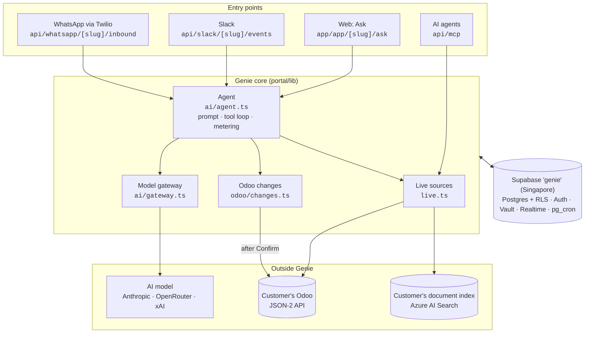
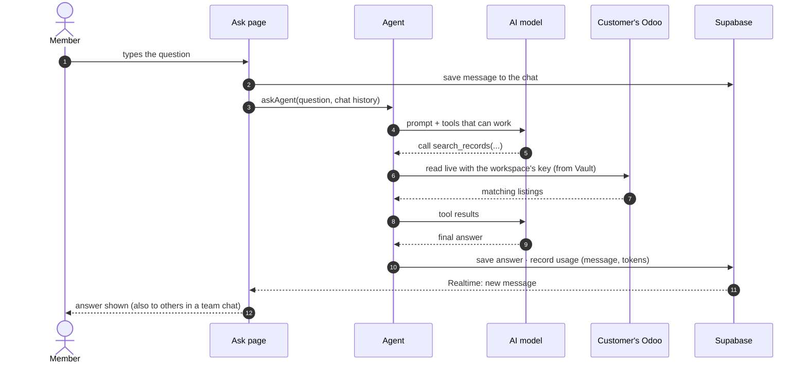
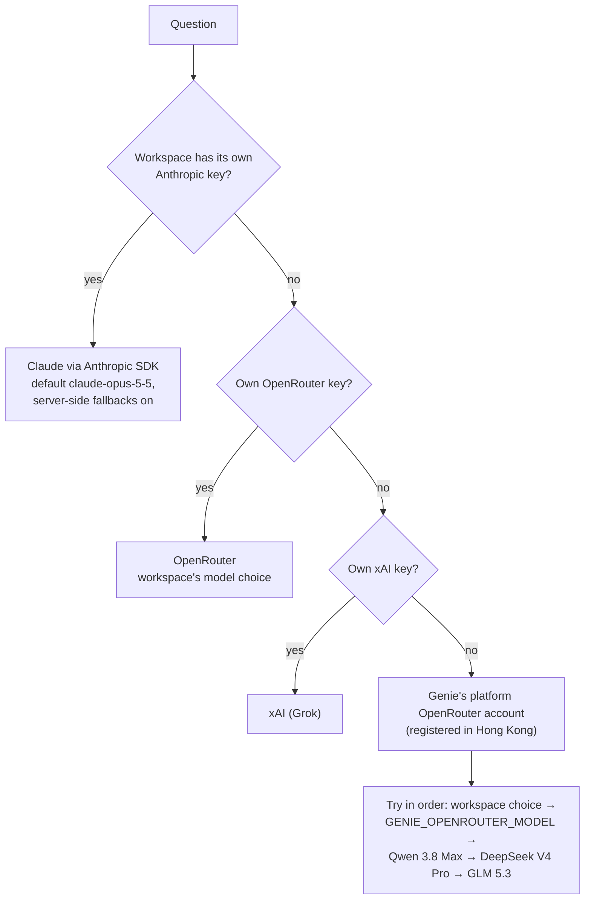
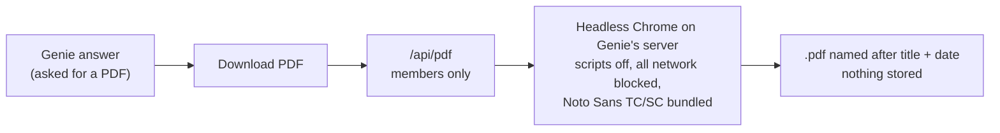

# 2. Architecture

[← Product](1-product.md) · next: [Data and security →](3-data-and-security.md)

Genie is one Next.js app (`portal/`) on Vercel plus one Supabase project. Every channel ends up in the same
**agent**. The agent asks an AI model, and the model calls **tools** that read the customer's systems live.

## System at a glance

| Part | Code | Job |
|---|---|---|
| Entry points | `app/…` | Check who is asking, then hand over to the agent (or straight to tools for MCP) |
| Agent | `lib/ai/agent.ts` | Builds the prompt, offers only tools that can work, runs the tool loop, records usage |
| Model gateway | `lib/ai/gateway.ts` | Picks the AI account and model (below) |
| Live sources | `lib/live.ts`, `lib/odoo/`, `lib/search/` | Turn tool calls into live reads of Odoo and the document index |
| Odoo changes | `lib/odoo/changes.ts` | Drafts and confirmed writes ([doc 4](4-odoo-changes.md)) |
| Supabase | `shared/supabase/` | Accounts, workspaces, keys (Vault), chats, usage, scheduled clean-ups |

## One question, end to end

An example on Ask: "Which 3-bedroom listings in Tai Koo Shing are under HK$40k?"

Lookups the model asks for in the same step run in parallel. Each question logs its timings
(`ask … total=…ms [model …ms tools …ms]`) in Vercel's runtime logs.

## Channels: how each one gets in

| Channel | Identity check | Then |
|---|---|---|
| Web (Ask) | Signed-in member (Supabase session cookie) | Agent runs as that member; tools run through `agent_tool()`, so the database checks membership |
| Slack | Slack signature (HMAC-SHA256, 5-minute window) | Acknowledge at once; post "⏳ Looking it up…", then replace it with the answer |
| WhatsApp | Twilio signature (HMAC-SHA1) | Text → answer sent through Twilio's Messages API. Photo/file → passed on unchanged to the company's document intake |
| MCP | Workspace API key (`gnk_…`, only its hash is stored) | Read tools only; each call is metered |

## Which AI model answers

OpenRouter calls ask providers not to keep data (`data_collection: deny`). The Hong Kong account can't use
Anthropic, OpenAI or Google models. Azure OpenAI keys can be saved but aren't used by chat yet.

## Tools

| Tool | Reads or does | Ask | Slack / WhatsApp | MCP |
|---|---|---|---|---|
| `search_records` | Keyword search in Odoo (leads, contacts, listings…) | ✓ | ✓ | ✓ |
| `get_record` | All fields of one Odoo record | ✓ | ✓ | ✓ |
| `find_contact` | People/companies by name, email or phone digits | ✓ | ✓ | ✓ |
| `search_knowledge` | Passages from the company's document index | ✓ | ✓ | ✓ |
| `workspace_info` | Workspace name, sources, record types | — | — | ✓ |
| Change tools (create lead/contact, note, follow-up, update fields) | Make a **draft** only | ✓ when switched on | — | — |

## Answer PDF

The browser's print dialog remains the fallback. Code: `lib/pdf/render.ts`, `app/api/pdf/route.ts`.

## Stack

| Part | Choice |
|---|---|
| Web app | Next.js 16 (App Router, server actions), Tailwind, Inter; `portal/` |
| Hosting | Vercel project `nextjs-dashboard` (team Infinity Duo Technology), genie.infiniduo.com, functions in **sin1** |
| Database / auth | Supabase `genie` (ref `xhaqzwznduxoosqtcrrm`, Singapore): Postgres with row-level security, Auth, Vault, Realtime, pg_cron |
| AI | Anthropic SDK (own Anthropic key) or OpenAI-compatible chat completions (OpenRouter / xAI) |
| PDF | `@sparticuz/chromium` + `puppeteer-core`, no outside service |
| Migrations | `shared/supabase/migrations/` |

## Code map (`portal/`)

| Path | What |
|---|---|
| `app/app/[slug]/ask` | Ask: chats (`chat-room.tsx`, `actions.ts`), draft cards (`proposal-card.tsx`), PDF (`answer-pdf.ts`) |
| `app/app/[slug]/settings` + `sources/`, `keys/`, `agents/`, `channels/` | Settings tabs (`?tab=`) |
| `app/app/[slug]/members` | Team, invites, invitation history |
| `app/api/mcp`, `app/api/slack/[slug]/events`, `app/api/whatsapp/[slug]/inbound`, `app/api/pdf` | Outside entry points |
| `components/workspace-shell.tsx` | Top bar, sidebar (chats under Ask, source and channel status), account menu |
| `lib/ai/` | Agent, gateway, model options, tool definitions |
| `lib/live.ts`, `lib/odoo/`, `lib/search/` | Live sources and Odoo changes |
| `lib/slack/`, `lib/whatsapp/`, `lib/pdf/` | Channel and PDF helpers |
| `lib/brand.ts` | The product name (one place, so a rename is cheap) |
