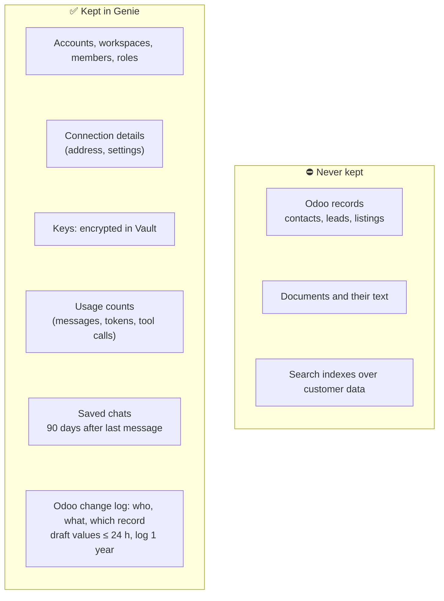
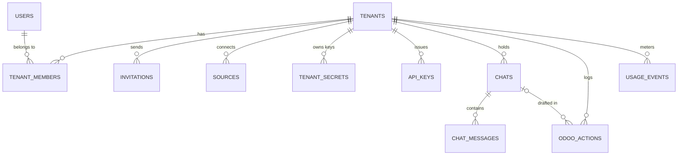
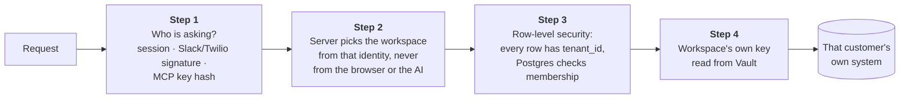

# 3. Data and security

[← Architecture](2-architecture.md) · next: [Changes in Odoo →](4-odoo-changes.md)

## What Genie keeps, and what it never keeps

Everything in "Never kept" stays in the customer's own systems and is read live when someone asks.

Saved chats can quote customer data in Genie's answers. That's why they are deleted automatically and the
privacy policy names them.

### How long things are kept

| Data | Kept for | Removed by |
|---|---|---|
| Saved chats and their messages | 90 days after the last message, or until deleted by the author / an owner or admin | pg_cron `genie-chat-retention`, daily 03:00 HKT |
| Odoo draft values | Until decided, at most 24 hours | pg_cron `genie-odoo-actions-cleanup`, hourly |
| Odoo change log (who, what, which record) | 1 year | Same job |
| Invite links | 7 days, single use, renewable | Expiry check |
| WhatsApp messages, Slack threads | Not stored (Slack history is read back from Slack) | — |

## Data model

| Table | Holds | Who can see it |
|---|---|---|
| `tenants` | A workspace: name, slug, plan, `settings` (AI model choice, channels, Odoo-change switches) | Members read; owner/admin update |
| `tenant_members` | User ↔ workspace, with role | Members read; owner/admin manage |
| `invitations` | Email, role, **token hash**, expiry, accepted date | Owner/admin |
| `sources` | Connected systems: kind (`odoo_json2`, `azure_search`…), non-secret settings, status | Members read; owner/admin manage |
| `tenant_secrets` | Key name and last 4 characters; **the value lives in Vault** | Owner/admin; values only via the server |
| `api_keys` | MCP keys, **hash only** | Owner/admin |
| `chats`, `chat_messages` | Saved Ask chats and messages | Team chat: members; private: author |
| `odoo_actions` | Drafted and made Odoo changes | Owner/admin, or the requester |
| `usage_events` | Metering for billing | Written by the server |
| `records`, `passages` | Old copy design, demo data only, not used for customers | — |

## How workspaces stay apart

Every request passes the same layers. A mistake in one layer is caught by the next.

- **Row-level security** is on every table. Policies use `private.is_member`, `private.has_role` and
  `private.can_see_chat`.
- **The server's secret key** (`SUPABASE_SECRET_KEY`) is used only on the server: to read keys for live calls, to
  handle Slack/WhatsApp/MCP requests that have no signed-in user, and to write Genie's answers and usage.
- **Isolation test:** `shared/supabase/tests/isolation_test.sql` creates test workspaces and checks they can't see
  each other. It is run by hand today; running it on every release is on the [roadmap](5-roadmap.md#platform-hardening).

## Keys

| Key | Kept in | Who can see it |
|---|---|---|
| Customer keys (Odoo reading and writing, search, AI, Slack, Twilio) | Supabase Vault | Owners/admins can reveal one on click (`reveal-action.ts`); the server reads them for live calls |
| MCP keys `gnk_…` | Hash only | Nobody, not even owners; revoke and make a new one |
| Platform keys (`SUPABASE_SECRET_KEY`, `OPENROUTER_API_KEY`) | Vercel, marked Sensitive | Server only, never `NEXT_PUBLIC_` |

Odoo reading and writing use **separate keys** on purpose, so a dedicated "Genie" Odoo user can be given write
access without touching reading.

## Sign-in and invites

- Email + password through Supabase Auth; Google and Microsoft are set up but shown as "coming soon".
- Invites are single-use links (only the hash is stored), valid 7 days. Until email sending exists,
  **a held link works like a key**: whoever has it can join. Emailed invites with a code are on the roadmap.

## Known gaps

| Gap | Fix planned |
|---|---|
| Isolation test is manual | Run on every PR ([roadmap](5-roadmap.md#platform-hardening)) |
| The change log is an ordinary table that the server could edit | Tamper-evident log ([roadmap](5-roadmap.md#platform-hardening)) |
| Invite link = key | Emailed invites with a 6-digit code |
| Anyone who can message the Slack bot or the WhatsApp number can ask | Link members to their Slack user / phone |
