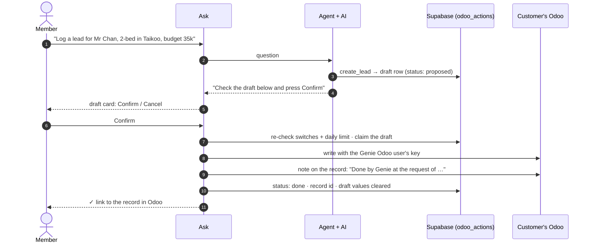
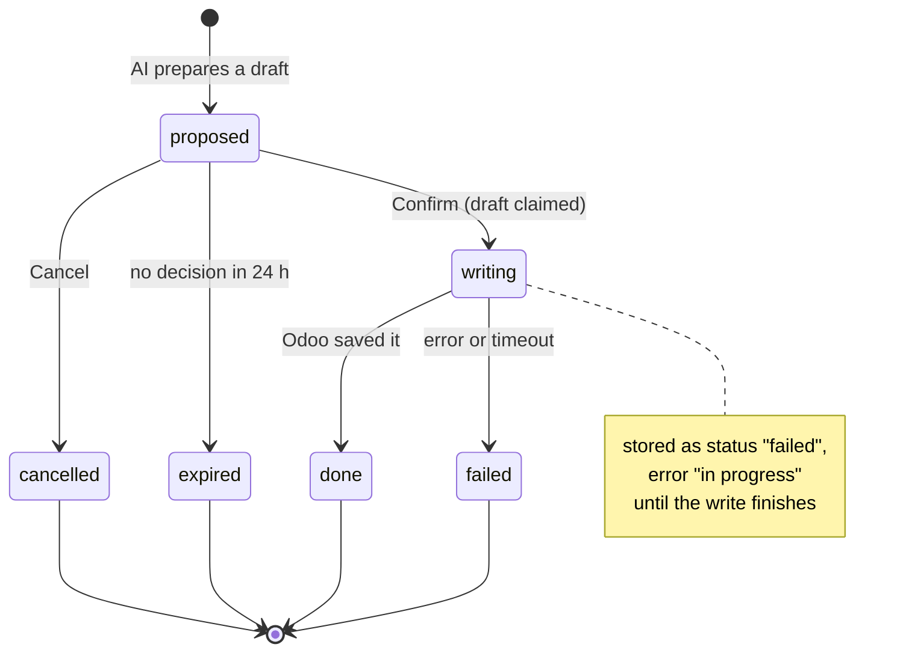

# 4. Changes in Odoo

[← Data and security](3-data-and-security.md) · next: [Roadmap →](5-roadmap.md)

**Genie never changes Odoo on its own. The AI can only prepare a draft; a person presses Confirm, and only then
does Genie write.** Off by default; web (Ask) only.

## The flow

## A draft's life

Every row's draft values are cleared once it's decided. Who / what / which record stays for one year, shown in
**Settings → Activity**.

## What an owner can switch

Settings → Data sources → **Changes in Odoo** (stored in `tenants.settings.odoo_changes`):

| Setting | Choices |
|---|---|
| Master switch | Off (default) / on |
| Write key | API key of a dedicated Genie Odoo user (Vault `odoo_write_key`), separate from the reading key |
| Actions | `create_lead`, `create_contact`, `add_note`, `schedule_follow_up`, `update_record`, each on/off plus who may ask |
| Fields allowed for updates | `model:field` pairs, picked from Odoo's own field list |
| Daily limit | Default 50 changes |

## Safeguards

| Safeguard | Why |
|---|---|
| Draft first, person confirms | The AI can misread a request; nothing reaches Odoo unseen |
| Only the requester or an owner/admin can confirm | A member can't confirm someone else's change |
| Switches and limit checked again at Confirm | Turning a switch off also stops drafts already waiting |
| Draft claimed before writing | A double click can't write twice |
| Salesperson / to-do owner = the Odoo user with the member's email | The record shows who it belongs to |
| "Done by Genie at the request of …" note on the record | Odoo's own history shows where the change came from |
| Separate write key | A dedicated Odoo user with only the rights Genie needs |

## Known weakness

If Odoo saves the change but its reply times out, Genie marks the draft **failed** and drops it. Asking again
then creates a **duplicate**. The fix (an operation key written with the change and checked before marking failed) is
item 1 of [platform hardening](5-roadmap.md#platform-hardening).

C21 has only one Odoo user, so the same key is pasted into both reading and writing for now.
