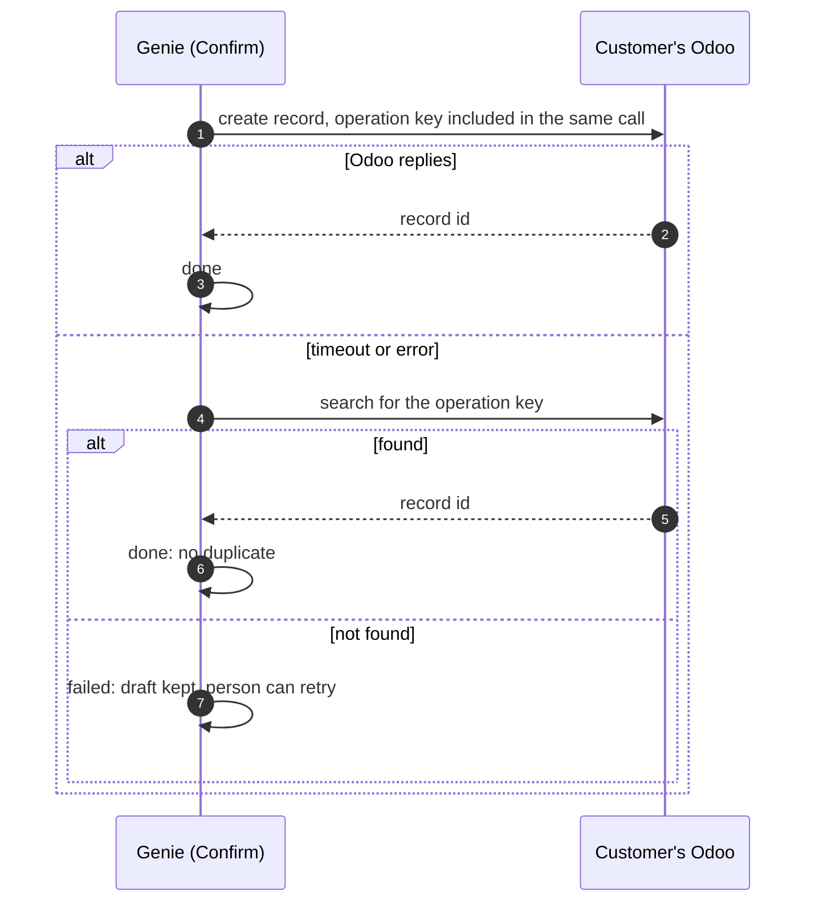
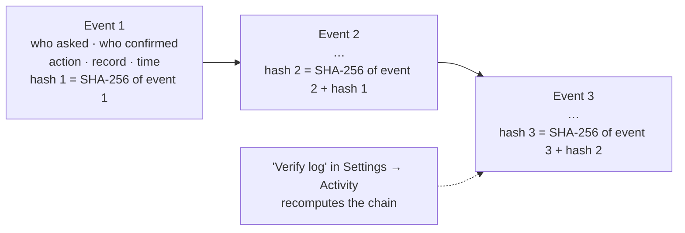

# 5. Roadmap

[← Changes in Odoo](4-odoo-changes.md) · next: [Operations →](6-operations.md)

## What comes next, by value

| # | Add | Why |
|---|---|---|
| 1 | Fix what the C21 trial shows: search quality on listings, speed, answer layout | Real use decides what matters |
| 2 | [Platform hardening](#platform-hardening): reliable Odoo changes, tamper-evident log, isolation tests on every release | A customer's IT department can sign off; no duplicates in the customer's Odoo |
| 3 | Odoo changes from Slack and WhatsApp (needs members linked to their Slack user / phone) | Agents act where they already chat |
| 4 | Answer quality: "Odoo wins on current facts" rule, fixed layout, vector search on C21's index | Trust |
| 5 | Email sending (Resend): emailed invites with a code, password reset for everyone | Security, onboarding |
| 6 | Stripe plans and limits; usage page | First paying customer |
| 7 | Document add-on (flyer/photo → Odoo), rebuilt into Genie | Premium upsell, proven at C21 |
| 8 | More live sources (read-only SQL, SharePoint/Drive search), Teams, email intake, Odoo MCP mode, a real WhatsApp number ([research](research/whatsapp.md)) | Sell beyond Odoo users |

**Gate before the first paying customer:** the demo workspaces pass a fixed question set
([demo data](decisions.md#demo-data-proposed-to-confirm)), plus the "Now" items of platform hardening below.

Items waiting on a person (tests, decisions) are in [status](status.md).

## Platform hardening

What Genie needs before a customer's IT department can approve it.

### Now: before the first paying customer

| # | What | Today | Plan |
|---|---|---|---|
| 1 | **Reliable Odoo changes** | One change can take several Odoo calls (record, then the "Done by Genie" note). If Odoo saves but the reply times out, the draft is marked failed and dropped; asking again creates a **duplicate** | Operation key written with the change; check Odoo before marking failed; keep the draft until the outcome is known (diagram below) |
| 2 | **Tamper-evident Activity log** | `odoo_actions` is an ordinary table; the server could edit or delete a row | Insert-only events chained by hash (diagram below) |
| 3 | **Isolation tests on every release** | `isolation_test.sql` is run by hand in the SQL editor | Run automatically on every PR touching migrations or `portal/lib`; cover every entry point (Ask, MCP key of workspace A asking for B's data, Slack/WhatsApp routed by slug) |
| 4 | **The server decides the workspace** | Mostly true already | A written rule with a test: workspace, source and key always come from the server's own identity check, never from the browser, the AI's tool arguments or the message text. Include a prompt-injection case ("use workspace X's data") |

#### 1. Reliable Odoo changes: planned flow

- The key is the draft's id (`odoo_actions.id`), written to a field or the note/to-do text **in the same call** as the
  change, so Odoo saves both or neither.
- Field updates can be repeated safely; creates, notes and to-dos can't, so those need the key.
- No Odoo module is needed.

#### 2. Tamper-evident Activity log: planned design

- Insert-only: no update/delete rights; a trigger rejects changes. Changing an old event breaks every hash after it.
- **No record contents**, only who / what / which record / when, the same as today's one-year log, so it stays
  within "no copy".
- The one-year clean-up removes events from the oldest end only and keeps the last removed hash as the new start.
- Outside timestamping (RFC 3161, e.g. Hongkong Post CA) only if a customer asks.

### Later: when a customer needs it

| What | Plan |
|---|---|
| **Outside-party access** | Invited guests (tenants, owners, clients) with scoped, revocable access to a narrow view: no member seat, no Odoo licence. For when Genie answers people outside the company |
| **Deadlines and reminders** | Genie watches dates in the customer's system (lease expiries, rent reviews, break clauses, follow-ups) and reminds the owner on Slack/WhatsApp, recording that the reminder was delivered. Dates are read live; only the reminder sent is kept |
| **Activity export** | A dated, ordered export of the Activity log with its hashes and instructions, so a customer's auditor can check it independently |
| **Property workflows** (agencies, landlords) | Notices sent with proof of sending; key dates checked against the signed lease (an amendment sends dates back for checking); handover photos timestamped on site. Built on the log and reminders above |
