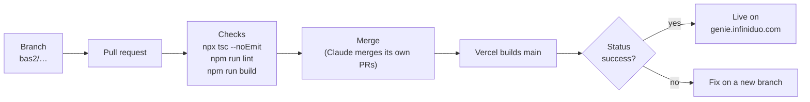

# 6. Operations

[← Roadmap](5-roadmap.md) · [Design docs](README.md)

## Release flow

Database changes are migrations in `shared/supabase/migrations/`, applied to the `genie` project. To run the portal
locally, see [`portal/README.md`](../../portal/README.md#run-locally).

## Settings in Vercel

| Variable | What | Visibility |
|---|---|---|
| `NEXT_PUBLIC_SUPABASE_URL`, `NEXT_PUBLIC_SUPABASE_PUBLISHABLE_KEY` | Supabase project and public key | Browser |
| `NEXT_PUBLIC_SITE_URL` | https://genie.infiniduo.com | Browser |
| `SUPABASE_SECRET_KEY` | Server access to Supabase | **Sensitive**, server only |
| `OPENROUTER_API_KEY` | Genie's platform AI account (Hong Kong) | **Sensitive**, server only |
| `GENIE_OPENROUTER_MODEL` (optional) | Comma-separated models tried first on OpenRouter | Server |
| `GENIE_ANTHROPIC_MODEL`, `GENIE_XAI_MODEL` (optional) | Model for workspaces with their own Anthropic / xAI key | Server |

## Scheduled jobs (pg_cron in Supabase)

| Job | When | Does |
|---|---|---|
| `genie-chat-retention` | Daily 03:00 HKT | Deletes chats idle for 90 days |
| `genie-odoo-actions-cleanup` | Hourly | Expires Odoo drafts after 24 h, clears decided drafts' values, deletes log rows after a year |

## Dates to watch

| Date | What |
|---|---|
| **2028-10-15** | Microsoft Entra client secret for sign-in expires: renew before |
| Before the first paying customer | Supabase Pro (free projects pause when idle), email sending, Stripe, a real WhatsApp number, platform hardening |

## Region notes

- Vercel functions run in **sin1** (Singapore) next to Supabase (ap-southeast-1).
- The platform OpenRouter account is registered in Hong Kong, so Anthropic, OpenAI and Google models refuse it.

## Things outside Genie that it depends on

| Dependency | Why it must keep running |
|---|---|
| Legacy `odoo-bas-sync` (Azure Function) | Fills C21's `properties-index`, which Genie searches |
| Old Slack bot Azure Function | Fallback if C21's Slack app is pointed back |
| C21's n8n document intake | Receives photos/files sent to Genie on WhatsApp |
