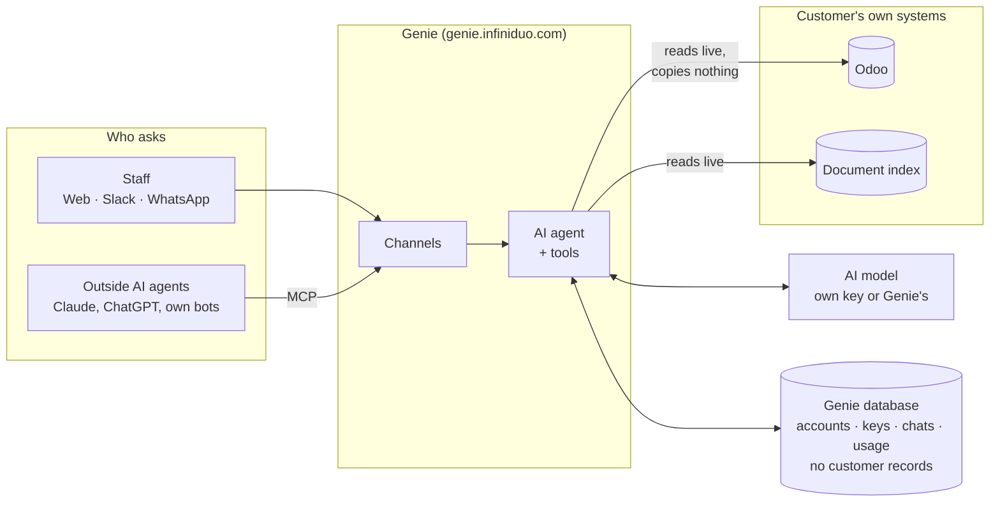

# Genie: design docs

**Genie answers staff questions from their company's own systems, live, on the channels they already use, and
never keeps a copy of the company's records.**

Live at **https://genie.infiniduo.com** · first customer workspace: C21 · status as of 2026-10-21

## Read in this order

| # | Doc | What you'll learn | Who it's for |
|---|---|---|---|
| 1 | [Product](1-product.md) | What Genie does, for whom, its rules, what C21 has today, known limits | Everyone |
| 2 | [Architecture](2-architecture.md) | How a question becomes an answer: parts, channels, AI model choice, tools | Developers |
| 3 | [Data and security](3-data-and-security.md) | What Genie keeps and never keeps, data model, how workspaces stay apart | Developers; anyone answering a customer's IT or privacy questions |
| 4 | [Changes in Odoo](4-odoo-changes.md) | How Genie writes to Odoo safely: drafts that a person confirms | Developers, product |
| 5 | [Roadmap](5-roadmap.md) | What comes next, including platform hardening | Everyone |
| 6 | [Operations](6-operations.md) | Release flow, settings, scheduled jobs, dates to watch | Whoever runs Genie |

**Also here:** [Status](status.md) (waiting on a person, open decisions, recently shipped) ·
[Decision log](decisions.md) · [WhatsApp research](research/whatsapp.md)

**Elsewhere:** build details per feature in [`portal/README.md`](../../portal/README.md) · working rules for this repo in the root [`CLAUDE.md`](../../CLAUDE.md) · database in
[`shared/README.md`](../../shared/README.md).
