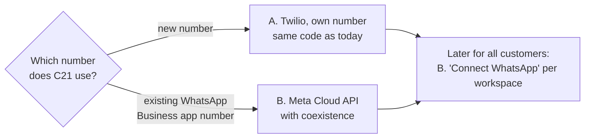

# WhatsApp: going beyond the Twilio Sandbox

[← Design docs](../README.md) · research 2026-10-17

Today Genie's WhatsApp runs on Twilio's shared Sandbox (+1 415 523 8886, trial account): text goes to Genie;
photos and files go unchanged to C21's n8n document intake. A real number is needed before staff use it.

## Options

| Option | What | For | Needs |
|---|---|---|---|
| **A. Twilio, own number** | Same code as today (Twilio Messages API) with a real sender | **C21 now** | Meta Business Portfolio (admin), Meta business verification (~1–2+ weeks), approved display name, a number not active on regular WhatsApp |
| **B. Meta Cloud API + Embedded Signup v4** | Infinity Duo as Meta Tech Provider; "Connect WhatsApp" popup per workspace (like Slack); new webhook with X-Hub-Signature-256 | **Genie SaaS** later | Infinity Duo business verification + Meta app review; v2 signup retired 2026-10-15 |
| **C. Reseller** (360dialog, YCloud …) | Like A, other pricing / HK support | Alternative to Twilio | Similar to A |

## Rules

- Since 2026-01-15 Meta bars *general-purpose* AI chatbots on the Business Platform (AI as the product). Task-bound
  business bots over a company's own data are fine, so **each customer uses its own number, never one shared
  "Genie" number**.
- A separate "AI Providers" pricing policy applies since 2026-02-16 (updated 2026-05-12). Check it before going live.
- "Coexistence" (option B) lets a company keep its WhatsApp Business app on the same number (no groups; broadcast
  lists read-only).
- Odoo changes on WhatsApp will need a phone number on each member's profile.

## Pricing

- Per message since 2025-07. Replies inside the 24-hour window are free (Meta's page).
- Messages Genie starts need paid templates. HK utility rates rose on 2026-07-01: ~US$0.026 utility / ~0.073
  marketing per secondary sources. One blog claims service replies are charged from 2026-10-01 (unconfirmed).

## Recommendation

A for C21 now; start Infinity Duo's Meta business verification; then build B for Genie customers.
Open: which number C21 uses, and whether to start verification.
